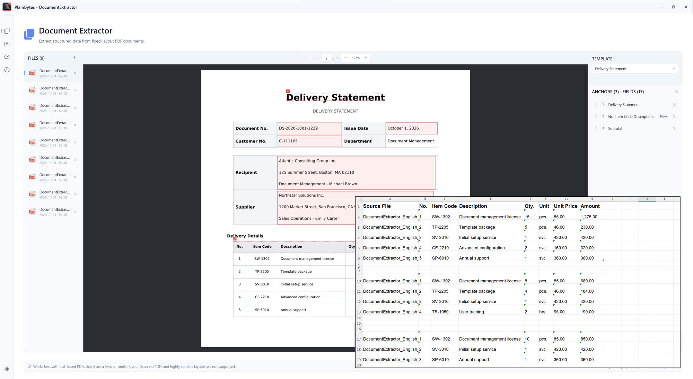

# PlainBytes DocumentExtractor

**Extract data from PDFs. Stop copying it by hand.**

PlainBytes DocumentExtractor is a Windows desktop application that extracts fields and table data from text-based PDF documents with similar layouts and exports the results to Excel.

Define your extraction rules once, apply them to multiple documents, and review the results—all processed locally on your Windows PC.

## Features

- **Visual field extraction** — Select fields and table areas directly on PDF pages.
- **Batch processing** — Apply the same extraction rules to multiple PDFs with similar layouts.
- **Reusable templates** — Save, import, and export extraction configurations for recurring tasks.
- **Excel export** — Export extracted data to `.xlsx` workbooks, including document-level fields and table details.
- **Local processing** — PDF extraction runs on your Windows PC. Documents are not uploaded to PlainBytes servers as part of extraction.
- **Original files preserved** — Extraction does not modify your source PDFs.

## How It Works

1. **Add PDF files** — Select one or more documents with similar layouts.
2. **Define extraction rules** — Select the fields and table data you want to extract. Save the configuration as a reusable template if needed.
3. **Extract and export** — Run the extraction and export the results to an Excel workbook.

## Requirements

- Windows 10 or Windows 11, 64-bit
- PDF documents containing selectable text
- Documents with sufficiently consistent layouts for the same extraction rules to apply

**Limitations:** DocumentExtractor is designed for text-based PDFs. Scanned PDFs and image-only documents are not supported. The application does not provide OCR.

## Download

You can install the official application from the Microsoft Store:

[**Download PlainBytes DocumentExtractor**](https://apps.microsoft.com/detail/9PF07HL4S766)

The Microsoft Store version offers a 7-day free trial, followed by a one-time purchase. The current U.S. price is $17.49 USD; pricing may vary by region.

Trial and purchase checks apply to the official Microsoft Store package.

## Open Source

PlainBytes DocumentExtractor is open-source software licensed under the **GNU General Public License v3.0 (GPLv3)**.

You can review the source code, build the application yourself, and redistribute or modify it under the terms of the license. Self-built unpackaged builds are not gated by the Store trial or in-app purchase check; you may also modify or remove that check under GPLv3.

- [Source code](./)
- [License](./LICENSE)
- [Building from source](./BUILDING.md)
- [Changelog](./CHANGELOG.md)
- [Contributing](./CONTRIBUTING.md)
- [Trademarks](./TRADEMARKS.md)

### Corresponding Source (Store builds)

For each official Microsoft Store release, we publish the corresponding source code in this repository under a version-specific Git tag.

- Git tags use the complete Store package version (for example, `1.0.3.0` → `v1.0.3.0`).
- Find the source corresponding to your installed version under [Releases](https://github.com/plainbytesstudio/PlainBytes.DocumentExtractor/releases) or the repository's tags.
- The corresponding source includes the materials required under GPLv3 to build and modify the application.
- The default branch may contain newer changes and may not correspond to a particular Store release.

See [BUILDING.md](./BUILDING.md) for build instructions and [CHANGELOG.md](./CHANGELOG.md) for release history.

## Privacy

Document extraction runs locally on your Windows PC.

- Your PDF documents are not uploaded to PlainBytes servers as part of extraction.
- Extraction and export do not require an internet connection.
- Templates and extraction results are stored locally.
- You choose where exported Excel workbooks are saved.

For more information, see the [Privacy Policy](https://plainbytes.studio/privacy.html).

## Feedback and Contributions

Found a bug or have an idea for an improvement?

Please open an issue to report a problem or discuss a feature request. Contributions are welcome — see [CONTRIBUTING.md](./CONTRIBUTING.md). All contributions are subject to the project's GPLv3 license.

## About PlainBytes Studio

PlainBytes Studio creates practical Windows utilities designed to make everyday work simpler.

[Website](https://plainbytes.studio) · [Microsoft Store](https://apps.microsoft.com/detail/9PF07HL4S766)

---

Copyright © 2026 PlainBytes Studio. Names and logos are trademarks of PlainBytes Studio — see [TRADEMARKS.md](./TRADEMARKS.md).